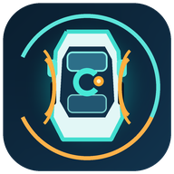

<div align="center">



# BYDMateCN

### 面向比亚迪 DiLink 的车机应用

[](https://developer.android.com)
[](https://kotlinlang.org)
[](https://developer.android.com/jetpack/compose)
[](LICENSE)
[](https://github.com/bluarry/BYDMateCN/releases)

**默认中文、以本地能力为主，为 DiLink 横屏车机优化。**

[English](docs/README.en.md) · [中文详细版](docs/README.zh.md)

面向比亚迪 DiLink 车机应用，提供行程能耗、车辆状态、自动化、多屏与盲区显示(电子后视镜)、解锁车音效、哨兵模式等。需启用并授权 ADB 的功能包括：实时车辆数据、车窗与空调等车辆控制、自动化车辆动作、分屏与多窗口、仪表投屏与 HUD、方向盘按键、盲区显示(电子后视镜)、车外喊话、锁车/解锁音效、哨兵模式及车辆诊断。

[主要能力](#继承自-bydmate-的能力) · [界面预览](#界面预览) · [使用说明](#应用使用说明) · [安装说明](#安装与使用) · [发布版本](https://github.com/bluarry/BYDMateCN/releases)

</div>

---

## 项目来源与定位

**BYDMateCN fork 自 [BYDMate](https://github.com/AndyShaman/BYDMate)**，本工作目录基于 [bluarry/BYDMate](https://github.com/bluarry/BYDMate) 分支继续开发。保留原项目版权、贡献者署名与 [LICENSE](LICENSE)，本项目为独立社区分支，不代表比亚迪官方适配。

在继承 BYDMate 功能的基础上，本分支面向中文用户和 DiLink 横屏车机，扩展车外音频、本地媒体、驻车影像与诊断等本地能力。当前主要适配目标为宋 L DM-i / DiLink；具体功能可用性取决于车型、DiLink 版本、固件权限和硬件配置。

- 应用显示名：**BYDMateCN**
- applicationId / namespace：`com.bydmatecn.app`
- Android：最低及目标 API 29；编译 API 35（编译版本不等于运行最低版本）
- ADB 依赖功能：实时车辆数据、车窗与空调等车辆控制、自动化车辆动作、分屏与多窗口、仪表投屏与 HUD、方向盘按键、盲区显示（电子后视镜）、车外喊话、锁车/解锁音效、哨兵模式及车辆诊断。未启用 ADB 时仍可查看已有行程历史和使用不依赖车辆接口的本地功能。
- 首次启动、未保存语言与资源回退：**简体中文**；设置 → 应用 → 语言可显式切换英语、俄语等。
- 原捐赠入口、自动弹窗与二维码默认隐藏，源码及资源保留，可通过构建开关重新启用。

## 继承自 BYDMate 的能力

BYDMateCN 完整保留 BYDMate 的核心能力，并在独立应用数据空间内提供以下功能：

| 分类 | 能力 |
|---|---|
| 行程与能耗 | GPS 行程、路线、距离/速度、BMS energydata 能耗、停车消耗、TRIP 1/2、费用与周期统计 |
| 混动与充电 | DM-i/DM-o 车辆计数器、电量/燃油/续航、充电记录、AC/DC 统计、电价与油价周期；未知数据不伪造 |
| 车辆状态 | 电池、电机、空调、轮胎、温度、12V 等实时读数；具体可用字段依赖固件 |
| 自动化 | WHEN→THEN 规则、车辆参数/时间/地点/按键等触发、冷却、驻车要求、确认窗口、动作结果日志、规则导入导出 |
| 多屏与窗口 | 仪表投射、中控分屏、多窗口、显示屏编排、悬浮信息组件；原厂安全画面应优先 |
| 盲区显示 | 转向联动摄像头显示，支持原有仪表/小窗路径；本分支的“电子后视”入口复用此能力 |
| HUD/导航 | 原有 HUD 与导航提示桥接、地图与路线；需匹配车型协议及导航应用 |
| 语音与分析 | 本地规则洞察、语音/智能体框架及模型管理；原离线识别模型偏俄语，默认中文界面不等于已经具备中文离线识别 |
| 系统与数据 | 自启动、服务、备份恢复、规则分享、故障诊断；原可选 ABRP、Telegram、云 AI、地图等网络模块仍存在 |

原项目功能不等于本分支全部离线，也不等于可以在普通安卓手机执行车机专用接口。网络模块的使用须由用户配置并审查数据用途。

## 本分支新增/补齐的本地能力

### 音频（工具 → 音频）

- 本地音频仅从用户选择的目录扫描，支持多个路径（最多32个）、浏览或输入绝对路径、移除目录与手动刷新；只读取目录直接包含的音频，不递归、不复制、不删除原文件。支持播放/暂停/停止、进度、音量、循环和可用输出设备选择。
- 锁车/解锁音效与本地媒体规则按完整路径引用扫描结果，支持不同目录下同名文件；目录移除、U盘拔出或文件删除后不自动替换，重新配置旧导入副本的音效。车机需授予存储读取权限；不可读目录会显示扫描状态。
- LRC 歌词导入与时间同步；仅使用本地资源。
- 麦克风录音：AAC，单次上限 60 秒。
- 本地 TTS 播放与 WAV 导出，依赖车机安装的可用 TTS 引擎/音色；使用车机本地能力。
- 固件音频属性路径：锁车事件 `11001`、车外 `11002`、锁车试听 `11003`，经固件证据确定，不猜测 stream/FID。手动试听上限 15 秒。
- 按住喊话：MIC → PCM 16kHz 单声道 → 车外 AudioTrack，最长 15 秒，默认限制音量；需要麦克风权限、驻车及人工确认车外实际出声。
- 锁车/解锁音效：人工启动前台布防服务，最长两小时；使用确认过的门锁边沿、去抖/冷却、P 挡和 12V 条件，单次音频最长 5 秒。不自启动、不申请持续唤醒、不承诺熄火全天工作。
- 焦点丢失、离开页面、停止/释放会取消播放或喊话；异步准备不能在用户停止后重新启动。

**11001/11002/11003 在固件出现不保证对应车型实际路由可用。车外音频和锁声必须先低音量驻车测试。**

### 电子后视与相机（工具 → 电子后视 / 驻车录像）

- “电子后视”复用原 BYDMate 的盲区显示，不重复实现或宣称为新硬件。
- 手动 AVM 仅探测固件存在的 `pano_h` / `pano_l` 标签；通道方向需实车标定，不按编号猜前后左右。
- 截图：JPEG；低频截图序列可打包 ZIP。
- MP4 分段录像：H.264、640×360、目标 5FPS、约 60 秒/段、无音轨；实际帧率与硬件编码器能力待实车验证。
- 事件标记保护上一已完成段、当前段、下一段；可基于驻车开门边沿标记，并去重。不是 AI 哨兵或真实 RAM 预录。
- 相册支持播放、保护/解除保护、导出和删除；录像配额 512MiB，只轮换本应用未保护录像。
- 倒车/原厂相机、权限/车辆状态丢失、离页、无帧看门狗优先释放 AVM；超过 24 小时的 `.pending` 隔离为 `.incomplete`，不冒充修复后的完整录像。
- 行驶录像仅为显式确认的前台测试模式：隐藏预览，有挡位/车速/相机占用检查；不是后台常驻行车记录仪，未验收前不要在日常道路使用。

### 本地自动化、媒体备份与诊断

- 新动作：本地截图、开始/停止 MP4、播放/停止音频、车外/锁车试听；规则默认停用，需人工启用、驻车和冷却，目标页面必须可见。
- 复用原方控学习与规则引擎，不凭编号猜车机按键；规则“已提交”不是硬件执行成功证明。
- SAF 本地媒体 ZIP 备份/恢复：音频、截图、录像与事件保护标记；路径穿越/重复条目/同名覆盖/配额校验，暂存后发布完整文件，失败回滚新文件。不备份权限、账号或系统设置，不是局域网传输服务器。
- 固件与权限只读检测、接口适配报告导出；不通过此入口刷机、提权或修改系统设置。
- 新增自动文件日志：本地页面操作/状态/错误、锁声服务、AVM 调用与回调，UTF-8 两份各 1MiB，异步有界队列滚动保存。
- 导出：**工具 → 固件与权限 → 导出本地问题日志 TXT**。目录为 `/data/user/0/com.bydmatecn.app/files/local-logs`；普通文件管理器无需访问私有目录，直接使用导出入口。
- 日志不主动记录音频或 TTS 输入，对常见敏感字段脱敏，不上传服务器；分享前仍需检查个人信息。强杀/断电可能丢尾部，卸载/清数据会删除，不等于完整系统 logcat。

## 界面预览

界面针对 DiLink 横屏车机设计。以下截图用于说明主要页面与操作位置；不同车型、固件、主题和窗口尺寸下，数据项目与排版可能略有差异。

| 首页与行程 | 自动化 |
|---|---|
|  |  |
| 首页集中显示车辆状态、续航、能耗与近期统计。 | 使用“触发条件 → 执行动作”创建本地规则。 |

| 工具与诊断 | 分屏显示 |
|---|---|
|  |  |
| 工具页集中提供车辆能力、音频、影像、诊断和日志入口。 | 可按车机支持情况组合导航与信息页面。 |

| 电子后视镜 | 悬浮信息组件 |
|---|---|
|  |  |
| 支持转向联动、转向灯期间持续显示及可配置延迟关闭。当前版本入口位于“工具”。 | 在其他车机应用上方显示必要的车辆与行程信息。 |

## 应用使用说明

### 1. 首次启动

1. 在车机安装 APK 后启动 BYDMateCN，按引导授予当前启用功能所需权限。
2. 在系统中允许应用后台运行；若车机提供“禁止后台应用”名单，请确保 BYDMateCN 未被禁止，否则行程、自动化、锁车音效和日志服务会被中止。
3. 打开应用的车辆接口/ADB 状态检查。需要车辆实时数据、车辆控制、电子后视镜、分屏、HUD、方向盘按键、车外音频或诊断时，必须先完成 ADB 与车机接口授权。
4. 首次测试车辆控制、摄像头或车外音频时保持 P 挡、车辆静止，并从低音量和单项功能开始。

### 2. 首页、行程与能耗

- **首页**：查看电量、续航、车辆状态、近期能耗与本地分析卡片；点击卡片可进入详细数据。
- **行程**：查看路线、距离、时间、平均速度、能耗和费用。费用计算前，请先配置电价、油价及生效周期。
- **充电**：查看 AC/DC 充电记录和统计。车辆未提供的字段显示为空，不会使用估算值冒充实测值。

### 3. 自动化

1. 进入 **工具 → 自动化**，新建规则。
2. 配置触发条件，例如车辆参数、时间、地点、方向盘按键或手动触发。
3. 添加一个或多个动作，并按需要启用驻车限制、冷却时间或执行确认。
4. 保存后先用安全、可观察的动作验证一次，再启用涉及车窗、空调或车辆控制的规则。
5. 在规则详情和文件日志中检查触发、跳过、执行成功或失败原因；“规则已触发”不等同于车机硬件一定执行成功。

### 4. 电子后视镜（盲区显示）

1. 进入 **工具 → 电子后视镜**，启用需要的左侧或右侧转向联动。
2. 可开启“转向灯亮期间持续显示”，避免画面在灯光闪烁间隔关闭。
3. 设置转向灯关闭后的延迟时间，再分别测试左右转向灯。
4. 摄像头被泊车、环视或其他应用占用时，应先退出占用页面再重试；行驶中不要操作配置界面。

### 5. 车外音频与锁车/解锁音效

1. 进入 **工具 → 音频**，添加一个或多个本地音频目录并授予持久读取权限。
2. 刷新文件列表，分别为锁车、解锁等事件选择音频；先使用“车外试听”确认专用外放路由可用。
3. 设置音量后启用锁车/解锁音效。车辆行驶中的自动落锁不会按驻车锁车事件播放。
4. 手动熄火引起的自动解锁会在熄火后的短暂识别窗口内被抑制；正常锁车后再次解锁仍按新事件处理。
5. 车外喊话需要麦克风权限；按住说话，松开结束。请勿在禁止外放或可能影响他人的场所使用。

### 6. 影像、分屏与悬浮窗

- **驻车影像/相册**：在 P 挡静止时打开摄像头预览、截图或录像；文件保存在应用本地媒体目录，可从应用内查看或导出。
- **分屏与多窗口**：先在工具页选择布局和目标应用，再启动分屏。应用不支持分屏或窗口过小时，系统可能调整或拒绝布局。
- **悬浮信息组件**：授予“显示在其他应用上层”权限后启用，并调整位置、尺寸及显示字段。
- **仪表投屏/HUD**：仅在车型、固件和导航应用协议匹配时可用；首次使用应停车验证显示内容和退出方式。

### 7. 日志与问题反馈

1. 进入 **工具 → 固件与权限**，打开文件日志。
2. 复现问题后使用“导出本地问题日志 TXT”，无需手动访问应用私有目录。
3. 反馈时说明车型、DiLink/固件版本、发生时间、操作步骤、预期结果和实际结果，并附导出的日志。
4. 日志默认按配置的保留周期清理，分享前仍应检查位置、设备标识等隐私信息。

## 适用范围与兼容性

| 能力 | 兼容性说明 |
|---|---|
| 前车提醒/识别 | 需要兼容的识别插件、数据源与车型协议 |
| 实时红绿灯倒计时/领航 | 需要合规的实时信号数据源，当前发行版不包含该服务 |
| 米篓宝专用蓝牙功能 | 需要对应设备及厂商协议支持 |
| 仪表触控板 | 依赖车型输入接口和厂商协议支持 |
| 熄火全天守护/后台 DVR | 受车机休眠、供电和后台唤醒机制限制；驻车录像按前台工作模式提供 |
| 云端服务 | 本分支新增能力以本地运行和本地文件为主，不依赖专属云端账号 |
| 中文离线语音识别 | 本地 TTS 取决于车机已安装引擎；离线语音识别需另行配置兼容的中文模型 |


## 安装与使用

1. 从 [Releases](https://github.com/bluarry/BYDMateCN/releases) 下载与版本对应的 APK，或安装本地构建产物。
2. 独立包名与原 BYDMate 可并存，但**不继承旧包数据或权限**。重新授权相机/麦克风、悬浮窗、通知访问、辅助功能等实际需要项。厂商包名白名单可能需合法固件配置。
3. 首次使用车外音频、相机和自动化功能时，请保持 P 挡驻车并从低音量、单路相机开始配置，避免多个应用同时占用车辆硬件。
4. 遇到问题可在工具页开启文件日志并导出 TXT；反馈时请附发生时间、车机版本、操作步骤与实际现象，并在分享前检查隐私信息。
5. 车辆控制、相机和车外音频功能应在安全驻车状态下完成配置；驾驶员请勿在行驶中操作应用。

## 构建

当前工具链：JDK 24.0.2+12、Gradle 8.14.5、AGP 8.7.3、Kotlin 2.1.0。本地依赖源优先使用国内镜像（官方源兜底），GitHub Actions 使用官方源，Android Studio SDK 路径通过本机 `local.properties` 配置。

```powershell
$env:JAVA_HOME = 'E:\JDK_other\openjdk\jdk-24.0.2+12'
& "$env:JAVA_HOME\bin\java.exe" -classpath gradle/wrapper/gradle-wrapper.jar org.gradle.wrapper.GradleWrapperMain :app:assembleDebug
```

输出：`app/build/outputs/apk/debug/BYDMateCN-<版本号>.apk`。测试可按 `com.bydmatecn.app.*` 包选择运行。没有发布签名配置时不能把 debug 包当正式签名发布版本。

### 车机 SDK 与权限

`bydauto-stubs` 是编译期接口签名，不提供车机硬件实现；执行时由固件上的 BYD 类、Binder 服务、HAL 和权限提供实现。源码原来使用反射的路径继续用反射，已有可确认接口复用 stub。普通 Android SDK 不能凭空生成 OEM 服务，APK 内也不打包厂商固件运行实现。


### 默认中文与捐赠开关

`LocalePreferences.DEFAULT_LANGUAGE` 为 `zh`，默认 `values` 与 `values-zh` 使用中文，俄语保留在 `values-ru`。显式选过语言的用户保留选择，不因升级强制覆盖。

`app/build.gradle.kts` 中 `DONATIONS_ENABLED=false` 隐藏设置捐赠卡片、启动提醒和 DonateDialog，二维码/收款资源不删除。以后启用前必须核对收款信息和来源归属，不能直接沿用原作者收款信息作为本分支收款方式。

更新仅检查 `bluarry/BYDMateCN` 的三段版本正式 Release；四段版本预发布版只供手动安装，不参与应用内自动更新，只接受与发布标签一致的 `BYDMateCN-<版本号>.apk`。安装前校验应用 ID、版本及签名；覆盖更新必须使用同一签名且递增 versionCode，不会下载原项目的安装包。

## 开源来源与许可证

感谢 BYDMate 原作者、贡献者与所基于分支的维护者；本分支保留原项目版权与许可证约束。请阅读 [LICENSE](LICENSE)，尤其非商业使用及再分发条件；fork 和功能扩展不改变原许可证，不意味着获得商业发布授权。
